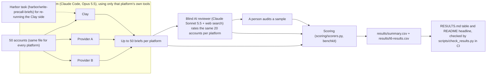

# AI Pre-Call Brief Benchmark: Clay vs two data providers

[](harbor/README.md)
[](docs/PREREG.md)
[](#license)
[](.github/workflows/check.yml)

This benchmark measures how well an AI agent can write pre-call research briefs for a sales team using only one data platform's own tools. The same agent (Claude Code on Opus 5.5) was asked for 50 briefs on each of three platforms: Clay and two anonymized data providers. We report how many briefs each run wrote, how accurate, specific and useful a blind review found them, how many stated a fabricated fact, and what the run took in steps, minutes and credits.



**Disclosure.** Run by [The Prompting Company](https://promptingcompany.com). This task is one of seven in a larger pre-registered agent study. The study's pre-registered plan was to publish all seven tasks together. This repository publishes one of them on its own, which departs from that plan; the other six tasks' results are available on request ([how to ask](#data-on-request)). The study's tasks were chosen from questions buyers ask AI assistants, including ones on which Clay wanted to be cited more. The two competitors were not offered a review before publication. Not independently reviewed. One run per platform.

**Related.** The [Enrichment Waterfall Benchmark](https://github.com/promptingcompany/clay-waterfall-enrichment-benchmark) is a separate benchmark by The Prompting Company on the same harness.

## Contents

| Path | What it is |
|---|---|
| [`RESULTS.md`](RESULTS.md) | The full results table, the caveats and what each agent did |
| [`METHODOLOGY.md`](METHODOLOGY.md) | The method for this task, and what was done in review |
| [`docs/`](docs) | [`PREREG.md`](docs/PREREG.md) (where the frozen method lives), [`BENCHMARK-CARD.md`](docs/BENCHMARK-CARD.md) (one-page summary and limits), [`DATA-DICTIONARY.md`](docs/DATA-DICTIONARY.md) (every results column), [`PRIVACY.md`](docs/PRIVACY.md) (personal data used), [`REPRODUCTIONS.md`](docs/REPRODUCTIONS.md) (reproduction log), [`CHANGELOG.md`](docs/CHANGELOG.md) (changes after the freeze), [`CONTRIBUTING.md`](docs/CONTRIBUTING.md) (reporting errors, proposing changes), [`LICENSE-DOCS`](docs/LICENSE-DOCS) (CC BY 4.0 for docs and results) |
| `results/` | The published numbers: `t6-results.csv`, `summary.csv`, `audit-agreement.csv` and `manifest-t6.json` (a SHA-256 for every run file) |
| `tasks/` | The task spec, `precall-briefs.md` |
| `config/` | `bench.json`: platforms, the prompt, agent limits and the pass line (not the frozen study config) |
| `scoring/` | `scorers.py`, the pass-line check |
| `scripts/` | `reproduce.sh`, the AI reviewer, the human-audit helper, the interval and kappa script, and `check_results.py` |
| `harbor/` | The Clay task as a Harbor task |
| `tests/` | Scorer, review, kappa and published-numbers tests on made-up data |
| `bench` | Runs the `benchkit` harness on this repository |
| `requirements.txt` | The pinned `benchkit` harness |
| `LICENSE` | MIT, for the code |
| `CITATION.cff` | How to cite this benchmark |
| `SECURITY.md` | How to report a security problem or a data concern |
| `.github/` | The CI checks and the issue templates |
| `.env.example` | The keys to set; copy to `.env` |
| `.python-version` | The Python version the checks run on |
| `.zenodo.json` | Archive metadata |
| `.gitignore` | Keeps private data and keys out of the repository |

## Task

The task was the sixth of the seven in the study ([tasks/precall-briefs.md](tasks/precall-briefs.md), pre-registered). Every agent got the same file of 50 accounts (company domain, account name, one contact's name and title) and this prompt, plus the fixed rules in [METHODOLOGY.md](METHODOLOGY.md) section 6:

> We sell a sales-data platform to B2B SaaS companies. For each account in input/t6-accounts.csv, produce a 3-bullet pre-call brief (what the company does; one recent development in the last 6 months with a source URL; one likely priority for the contact's role) and one personalized opening line. Save output/output.csv with exactly these columns: domain, bullet_1, bullet_2, bullet_3, first_line.

- **The agent.** Claude Code on `claude-opus-5-5`, run without a person, with the same prompt, tools and limits on every platform. Nobody told it which features to use.
- **Platform tools only.** Each agent used the platform's own command-line tool or API, with shell and file tools only: no web search or fetch tools, no MCP servers. Each run got only its own platform's key and worked in a throwaway folder holding only the input file. On Clay the interface was the Clay CLI signed in through the browser. The competitors are anonymized: their names, plan names and prices are not published.
- **Limits.** 60 minutes and a $10 model budget per run.

## Metrics

Full detail, the reviewer's rules and the rubric are in [METHODOLOGY.md](METHODOLOGY.md) section 7.

| Metric | What it is |
|---|---|
| Briefs written | Briefs with all five columns filled, of 50. A script counts them |
| Accuracy | 1–5: are the stated facts true per public sources |
| Specificity | 1–5: specific to this company, not generic |
| Usefulness | 1–5: would an account executive use it on a call |
| Fabrications | Reviewed briefs, of 20, where a stated fact is shown false or can't be found after a proper search |
| Status | Pass, or Partial for a run below the pass line |
| Steps and minutes | The agent's tool calls, and the wall-clock time of its run |
| Platform credit cost | Credits the run used × the platform's list price per credit ([RESULTS.md](RESULTS.md) says which price) |
| Model cost | What the agent's own model calls cost, billed separately and never added to the platform cost |

- **Pass line, set before the runs:** all 50 briefs written, accuracy of at least 3.5, at most 1 fabrication in the sample ([METHODOLOGY.md](METHODOLOGY.md) section 4).
- **Blind sample.** One set of 20 accounts is drawn and used for every platform. The 60 briefs are shuffled into one sheet with the platform hidden.
- **AI reviewer.** Claude Sonnet 5.5, a different model from the agent's, checks each brief against public sources with web search. It gives the three 1–5 scores and flags a brief as fabricated.
- **Human audit.** A person rated a random 20% of the accounts blind, twice (4 accounts, then 3 others). Agreement means within 1 point on each score and the same fabrication call. The bar we set for relying on the AI was 85% agreement. Neither audit round reached it (58% and 78%).
- **Published scores.** The average of every rating on file: the AI's 20 per platform and the person's 3 from the second audit round. A brief counts as fabricated if either rater flagged it. Each score is published with a 95% interval ([METHODOLOGY.md](METHODOLOGY.md) section 7).

## Results

<!-- generated:headline -->
Clay's briefs were the most accurate (4.78 of 5), with 0 fabricated facts found in the 20 briefs reviewed and all 50 written, at the lowest credit cost: about $0.46 for the 50 briefs, against $6.64 on Provider A and $1.60 on Provider B.
<!-- /generated -->

One run per platform; an AI reviewer scored 20 of each platform's 50 briefs. Full results, 95% intervals and caveats are in [RESULTS.md](RESULTS.md).

## Reproduce it

**Start here.** One script re-checks everything a clone can check. It makes `.venv`, installs the pinned harness, runs the tests, checks the published numbers against the results files and checks that the results contain no email addresses. If you have the private run folders (see [Data on request](#data-on-request)), it also checks them against the published hashes, re-scores the three runs and compares them with the published files.

```bash
scripts/reproduce.sh
```

Reproduction attempts, ours and anyone else's, are logged in [REPRODUCTIONS.md](docs/REPRODUCTIONS.md).

**With Harbor.** The Clay task is a [Harbor](https://harborframework.com/docs) task with the exact prompt and the same pass line. You need Docker, a Clay workspace with credits, an Anthropic key for the reviewer, and the accounts file (see Data below). [harbor/README.md](harbor/README.md) has the details and one setup check.

```bash
uv tool install --python 3.13 harbor
export CLAY_API_KEY=... ANTHROPIC_API_KEY=...
eval "$(harbor/clay-routine-env.sh)"   # your workspace's saved Clay routine IDs; needs the clay CLI signed in
harbor run -p harbor/write-precall-briefs -a nop                                        # grading check: scores 0
harbor run -p harbor/write-precall-briefs -a claude-code -m anthropic/claude-opus-5-5   # the benchmark's agent and model
```

**Score locally,** the way we did. This uses the `benchkit` harness, pinned by commit in `requirements.txt` (v0.1.3), on Python 3.12 (`.python-version`).

```bash
python3 -m venv .venv && .venv/bin/pip install -r requirements.txt
source .venv/bin/activate
python -I -m unittest discover -s tests
cp .env.example .env                         # fill in keys; never commit
# T6 is the task's ID in config/bench.json. Put the accounts file at private/datasets/t6-accounts.csv
./bench agent-batch --task T6 --platform clay --env "self-serve monthly"   # one agent run (claude and clay CLIs signed in); prints the run ID
./bench usage <run_id> --from-cli            # Clay: the data-credit balance drop (action credits aren't in it)
./bench blind-sample --task T6               # after every platform's run: private/review/T6-blind.csv
python3 scripts/ai_review.py T6              # AI verdicts: private/review/T6-blind-ai.csv
python3 scripts/review_audit.py make T6      # a blank 20% sheet for a person to fill in
python3 scripts/review_audit.py merge T6     # prints agreement, writes private/review/T6-final.csv
./bench blind-import --task T6 --file private/review/T6-final.csv
./bench score <run_id>
./bench summary                              # rewrites results/summary.csv from your runs
```

To run a competitor, describe it in a gitignored `private/platforms.json` (name, interface, allowed domains and prices under `platforms.provider_a` or `provider_b`) and record its usage with `./bench usage <run_id> --before <balance> --after <balance>`. Expect different numbers: an agent doesn't write the same briefs twice, vendor data changes daily, and the AI review varies by a few points between runs.

## Data on request

The accounts file names a contact at each account, so it is not in this repository. Neither are the briefs, the review sheets with the per-brief ratings, or the run folders. To ask for anything listed as on request, open an issue titled "Data request" on this repository; we share the private files with researchers only. They are deleted 90 days after publication ([METHODOLOGY.md](METHODOLOGY.md) section 8), so ask before then. [PRIVACY.md](docs/PRIVACY.md) says what personal data was used and how a person named in it can ask about theirs.

## Changes after pre-registration

The method was frozen before any counted run ([PREREG.md](docs/PREREG.md)). Everything that changed afterwards, including how the review was done and what was published, is listed with dates in [CHANGELOG.md](docs/CHANGELOG.md).

## License

- **Code:** MIT ([LICENSE](LICENSE)).
- **Documentation and results** (every `.md` file and everything in `results/`): [CC BY 4.0](https://creativecommons.org/licenses/by/4.0/) ([LICENSE-DOCS](docs/LICENSE-DOCS)). Give credit to "The Prompting Company".
